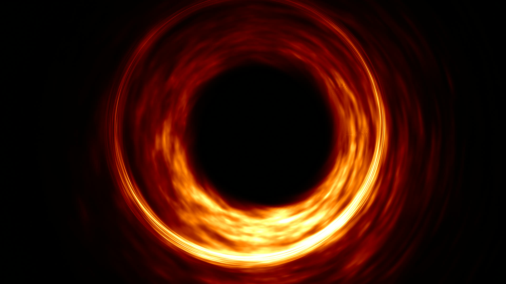
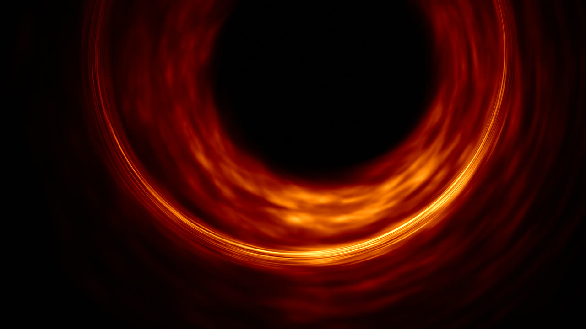
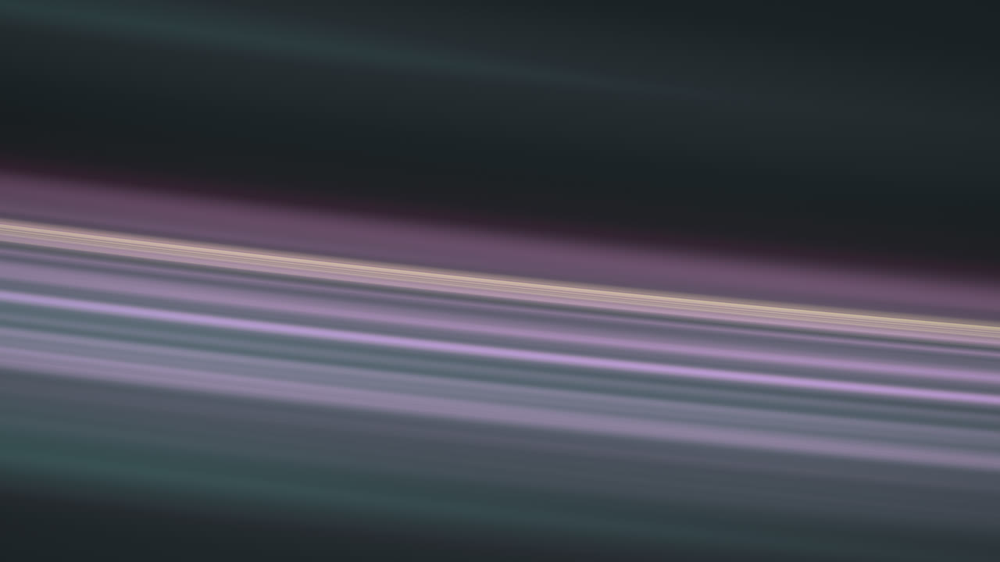
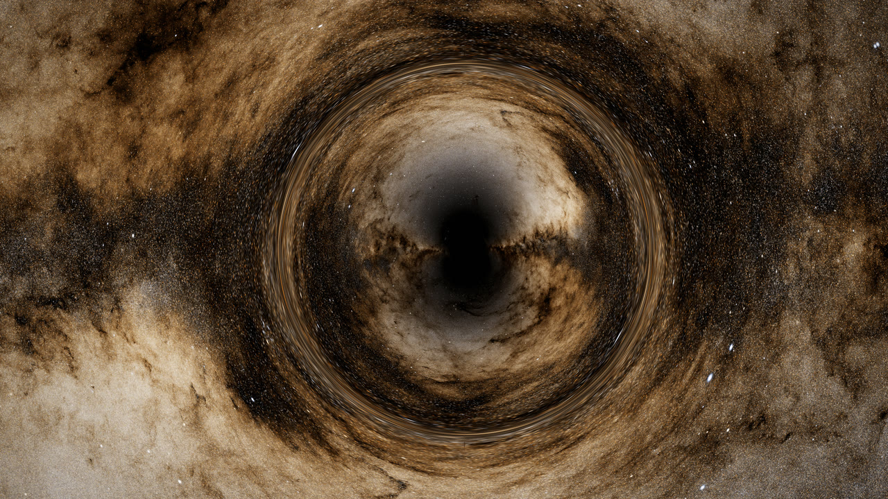
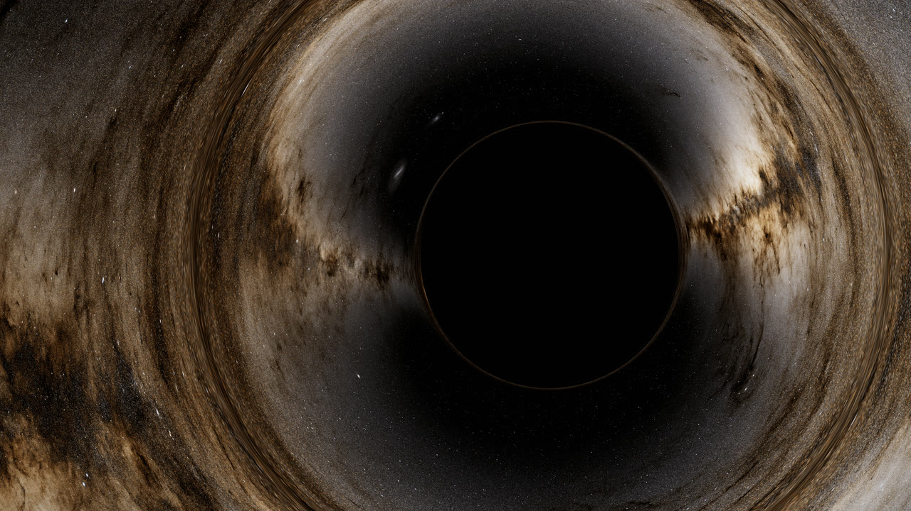
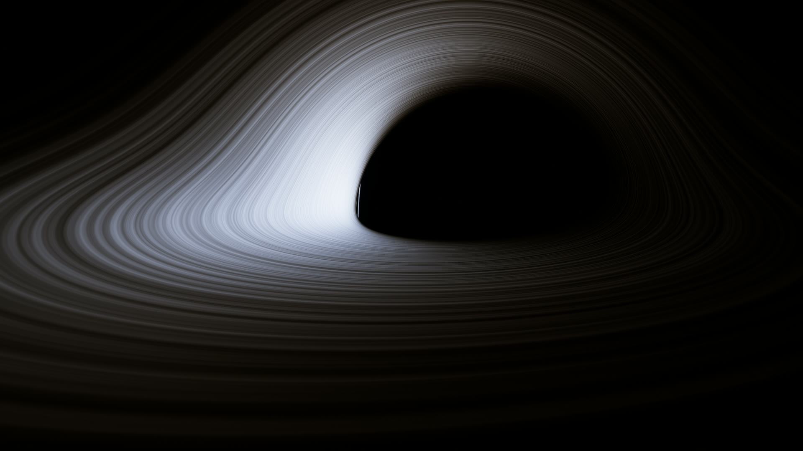

# Spacetime Optics

Spacetime Optics is a set of physically based GPU renderers for light bent by gravity, written in C++ and CUDA.  
It renders the photon rings of black holes, and what a telescope would see from Earth's gravitational focal point.

<p align="center">
  
</p>

## Black holes

<p align="center">
  
  
  
  
  
</p>

### Features

- Kerr geodesics traced in double precision (Carter-Mino equations, adaptive Dormand-Prince)
- M87* at 230 GHz:
  - Thermal synchrotron emission from a hot accretion flow
  - Flux normalised to the 0.6 Jy seen by the Event Horizon Telescope
  - Animated turbulence that keeps its light travel delays
- Zoom into the photon ring (up to x40,000), with the light coloured by the number of times it went around the hole
- Real sky behind the hole: the Gaia star map (1.7 billion stars), with doppler and gravitational shifts
- Thin accretion disk in true colours
- Self test against the analytic shadow edge
- Built with **CUDA** and **MPI**, frames are spread across all the gpus of one or more machines

## Earth as a gravitational lens

<p align="center">
  
  
  
</p>

Earth bends light too. A telescope 4,000 to 90,000 AU behind Earth, lined up with an exoplanet (here Proxima b), sees the planet's light bent into an Einstein ring around Earth.

### Features

- General relativity deflection, with Earth's oblateness (J2) and the Sun's tidal field
- Atmospheric refraction up to 1000 km, which beats gravity below ~107 km
- Earth rendered from NASA data:
  - Blue Marble surface, clouds and city lights
  - Ocean sun glint
  - Atmosphere scattering, ozone and airglow
- Spectral rendering (16 bands)
- Telescope view with diffraction through a real aperture
- Web viewer to move the telescope along and across the focal line

> [!TIP]
> Run `./lensim scenes/proxima_b.ini --report` to print the refraction and gravity tables.

## Planned Features

- Polarisation for the M87* images?
- Moon and planets in the Earth lens scenes?
- Wave optics near the focal line?

## Dependencies
Before compiling, make sure you have:

- an nvidia gpu (sm_80 or newer recommended, the geodesics use fp64)
- cuda 12 or newer and zlib
- mpi if you want to render on several gpus
- ffmpeg for the videos

## Installation

Build manually from source:
```bash
git clone https://github.com/orrnithogalum/spacetime-optics.git
cd spacetime-optics

cd blackholes && make && cd ..
cd lensing && make && cd ..
```

Use `make NOMPI=1` for a single gpu build, or `make ARCH=sm_89` for other gpus.

## Usage

### Black holes

```bash
cd blackholes
./bhrt --selftest

scripts/fetch_sky.sh
./bh-prep-sky data/sky/starmap_2020_32k_gal.exr data/sky/sky.bhsk

mpirun -np 8 ./bhrt shots/01_m87_eht.ini --out renders/01_m87_eht
scripts/encode_shot.sh renders/01_m87_eht
```

### Earth lens

```bash
cd lensing
scripts/fetch_earth_data.sh
scripts/prepare_earth_data.sh

mpirun -np 8 ./lensim scenes/proxima_b_explorer.ini --out out/explorer
scripts/make_video.sh out/explorer
```

Then open `out/explorer/viewer/index.html`:

- `LEFT / RIGHT` arrows or `SCROLL` → move the telescope along the focal line
- `UP / DOWN` arrows → move it off the axis
- `SPACE` → play
- `T` → switch to the telescope view

### Slurm clusters

> [!NOTE]
> Set `SBATCH_ACCOUNT` and `SBATCH_PARTITION` first, and `MODULES` if your cuda / mpi modules have other names.

```bash
source scripts/slurm/env.sh
sbatch --nodes=4 scripts/slurm/render.slurm shots/02_photon_ring_zoom.ini
```

Use one MPI rank per gpu. `blackholes/scripts/slurm/produce_all.sh` renders the whole film in 4K.

## Credits

- Star map: NASA/Goddard Scientific Visualization Studio, Deep Star Maps 2020 (Gaia DR2: ESA/Gaia/DPAC)
- Earth: NASA Visible Earth (Blue Marble, Black Marble) and GEBCO
- HUD font: Liberation Mono
